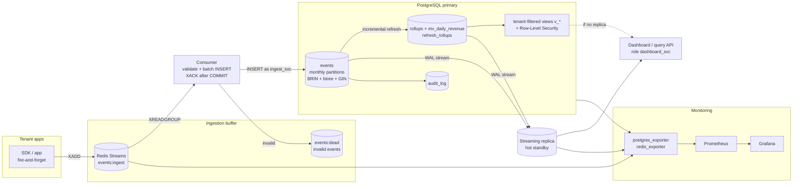

# Architecture and data flow

## 1. Data flow: ingestion to dashboard



| Stage | What it does | Why |
|---|---|---|
| Redis Streams | Absorbs bursts; decouples the SDK from database write latency | A slow commit or a failover pause must not make the SDK wait or drop events |
| Consumer | Validates tenant, event type and timestamp window; one multi-row `INSERT` per batch; acknowledges only after `COMMIT` | **At-least-once**: a crash between commit and ack re-delivers a batch, but never loses one |
| `events` | Append-only, monthly range partitions | Time-range queries touch few partitions; old data is dropped instantly |
| Rollups | `refresh_rollups()` rebuilds only recent days (watermark minus 1 day) | Dashboards read tiny tables instead of scanning 10M+ rows |
| Views `v_*` | Filter rollups by `app.tenant_id` | Materialized views cannot have RLS, so isolation is restored here |
| Replica | Hot standby fed by streaming WAL | Dashboard reads do not compete with ingest; also the failover target |

## 2. Partitioning design

```
events  (PARTITION BY RANGE (occurred_at))        PK (tenant_id, occurred_at, event_id)
 ├── events_2026_07   [2026-07-01, 2026-08-01)
 ├── events_2026_08
 ├── events_2026_09
 ├── events_2026_10   <- current month, receives writes
 ├── events_2026_11   <- pre-created (3 months ahead)
 ├── ...
 └── events_default   <- safety net: out-of-range events land here instead of failing ingest
```

- **Monthly** partitions, boundaries in **UTC**.
- `ensure_events_partitions(from, to)` creates any missing months; `run_maintenance()` keeps 3 months ahead.
- **BRIN** on `occurred_at` (`pages_per_range = 32`): events arrive in time order, so the index is tiny. It halved a time-range scan in the experiment.
- Other indexes are listed per query in `query_optimization.md`.
- A primary key on a partitioned table must include the partition key, hence `(tenant_id, occurred_at, event_id)`.
- `run_maintenance()` warns if `events_default` is not empty (a month was missing).
- Application roles hold privileges on the parent `events` only, so they cannot bypass RLS by querying a partition directly.

## 3. Retention and compression policy

| Data | Policy | Mechanism |
|---|---|---|
| Raw `events` | Keep **90 days** | `enforce_events_retention(interval '90 days', dry_run)` detaches and drops whole expired month-partitions (instant, no dead tuples, no `DELETE`) |
| Safety check | A partition is **never dropped before the rollups consumed it** | Compares `rollup_state.watermark` with the partition's upper bound; otherwise reports `SKIPPED` |
| Compression | Archive before dropping | `scripts/archive_partition.sh events_YYYY_MM` writes a `pg_dump -Fc` (zlib) copy to `backups/archive/` |
| Aggregates | Keep indefinitely | Rollups merge min/max, so history survives after raw partitions are dropped |

The retention function defaults to **dry run**. Call `SELECT * FROM run_maintenance(true);` to actually drop.
With TimescaleDB the same goals map to `add_retention_policy` and native columnar compression (`add_compression_policy`); this project uses native partitioning instead to show the mechanics.

## 4. Availability and recovery

| Goal | Implemented here | Production recommendation |
|---|---|---|
| Read scaling | Streaming replica (`docker/replica-entrypoint.sh`, `pg_basebackup` + replication slot) | Same |
| RPO < 1 min | Asynchronous streaming replication (lag is graphed) | Synchronous or low-lag replication; WAL archiving to object storage |
| RTO < 5 min | **Not automated.** Replica can be promoted manually (`pg_ctl promote`) | Patroni (or similar) for automatic failover |
| Backups | `scripts/backup.sh` (`pg_dump -Fc` + checksum), `scripts/restore_test.sh` (restore into scratch DB and compare 9 measures) | Add `pg_basebackup` + WAL archiving for point-in-time recovery |

Redis is the other single point of failure: it runs with AOF (`appendfsync everysec`), so up to ~1 second of buffered events can be lost on a hard crash. The consumer's at-least-once design protects against consumer and database failures, not against losing Redis itself.

## 5. Security layers

1. **Roles:** `capstone_admin` owns the schema and runs migrations (not a superuser). Group roles `app_ingest` (INSERT events only) and `app_dashboard` (read-only, plus own funnels). Login roles `ingest_svc` and `dashboard_svc` are created outside git from `.env`.
2. **RLS:** on 8 tenant-scoped tables, keyed on `app.tenant_id`; unset means no rows (fail closed).
3. **PII:** only an HMAC-SHA256 of the email is stored.
4. **Audit:** triggers on tenants, plans, subscriptions, payments; the log itself is append-only.
5. **Queries:** parameterised only; verified by `tests/security_check.py` (31 checks).

## 6. Operating notes
- `run_maintenance()` must be called on a schedule (cron, or `pg_cron` if installed). This repo does **not** schedule it.
- Production index builds on a live partitioned table should use the `CONCURRENTLY` recipe described at the top of `V6__query_optimizations.sql`.
